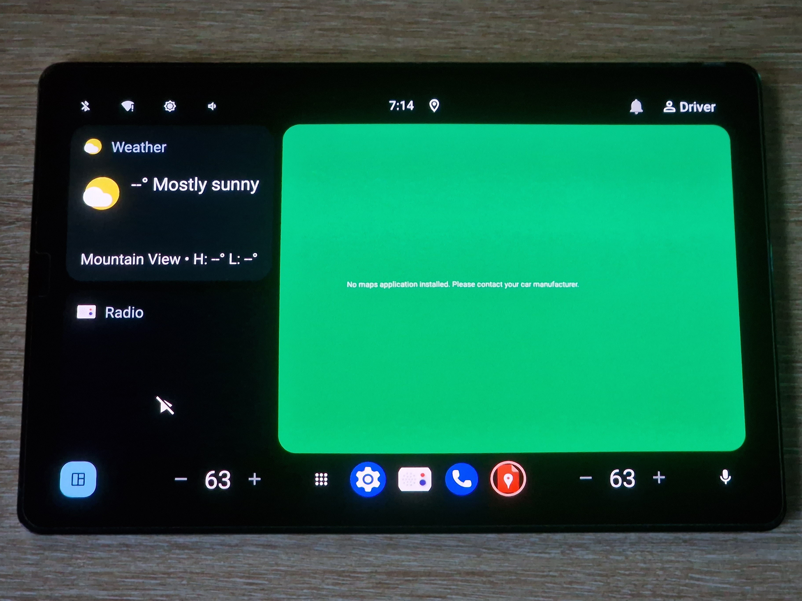
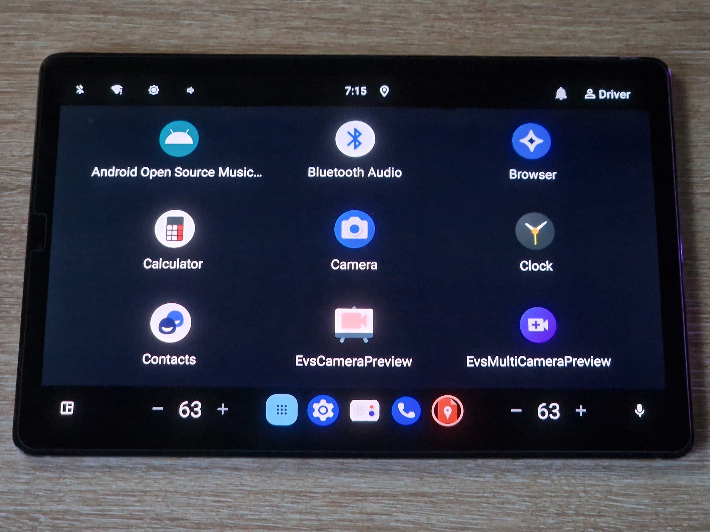
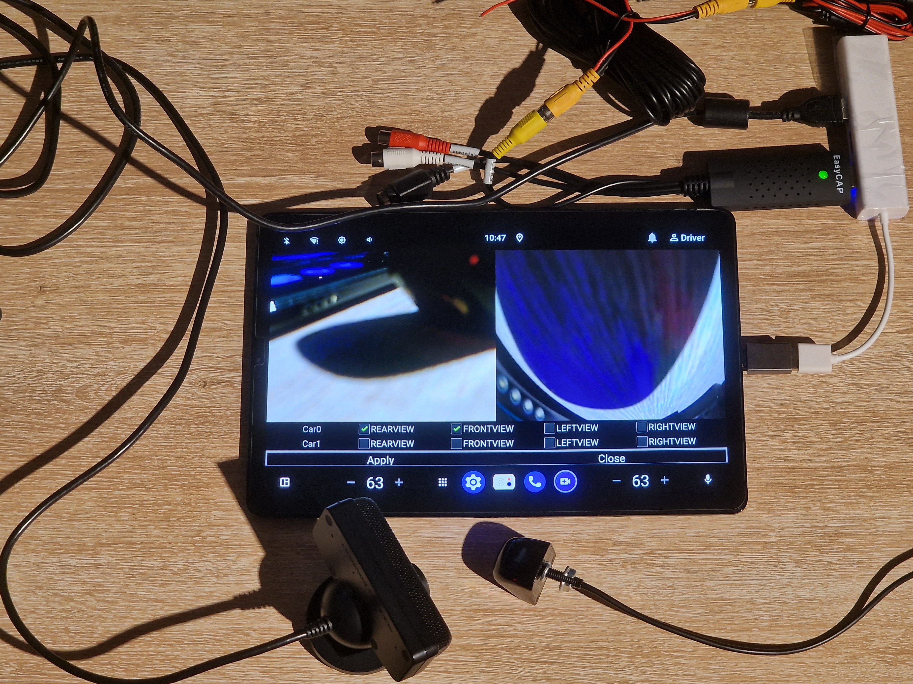
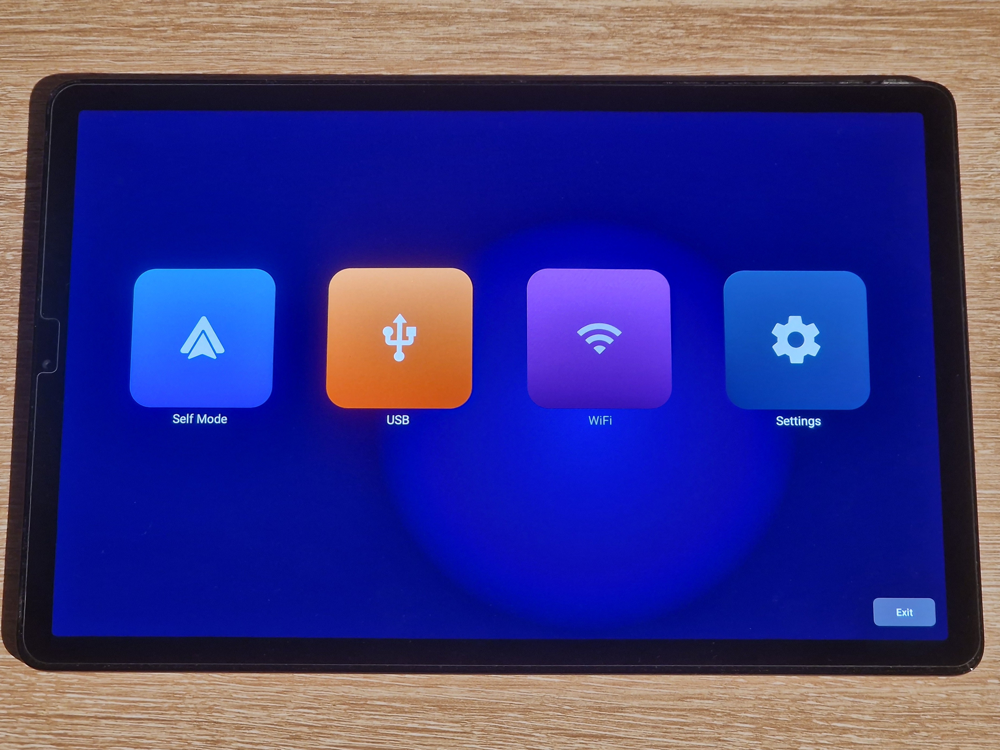

# Notes on building LineageOS Android Automotive

* [Background](#background)
* [Requirements](#requirements)
* [Preparation](#preparation)
* [Switching to automotive](#switching-to-automotive)
* [Enabling more features](#enabling-more-features)
* [Building](#building)
* [Installation](#installation)
* [What to expect during use](#what-to-expect-during-use)
* [Result](#result)
* [Tips](#tips)
* [Enabling kernel features](#enabling-kernel-features)
* [References](#references)

## Background

There are a few options if you want to add modern features to an older car.
The easiest is probably to replace the head unit. The cheapest could be to
repurpose an old phone or tablet you already own, or buy one second-hand.
What if that device was running
[Android Automotive](https://source.android.com/docs/automotive/start/what_automotive)
just like some newer cars?

A bit of research led me to
[these](https://www.reddit.com/r/LineageOS/s/lzLg9AEjI5)
[posts](https://medium.com/snapp-automotive/android-automotive-os-on-a-tablet-f805beb20f96)
from 2021 which showed that it is indeed possible thanks to
[LineageOS](https://lineageos.org/).
Both authors, [Al Sutton](https://github.com/alsutton) and
[Tom Pratt](https://github.com/tom-pratt), were later credited in the
[Changelog 26](https://lineageos.org/Changelog-26/#:~:text=Android%20Automotive,-%21) for helping to
bring Android Automotive support to the project. This same page talks about
building an Automotive GSI, but there isn't a lot of info out there about
building AAOS for a specific target and with more recent versions of Lineage.

Here I'll give the steps I took to build Android Automotive 15 for the Tab S5e
LTE. Theoretically the same steps could work on any device that supports
LineageOS 22.2. I couldn't try 23.2 (Android 16) because it's not currently
supported on the S5e. If you don't know anything about building Android then you
know as much as I did before doing this. I'm in part writing this as a guide I
would have liked to have.

## Requirements

- a device that is officially supported by LineageOS (here a Tab S5e LTE model SM-T725)
- there's no data you care about on that device
- a Linux computer (Docker probably works too)
- with 250 GiB of free space (bare minimum for this device)
- and 20 GiB of free space for ccache (optional, that's what I used)
- a few hours of time
- knowledge that this isn't officially supported by Lineage

Installing the latest official LineageOS build on your device is not necessary
since you could go straight from the stock OS to AAOS, but I'd recommend it at
least to see if everything works first, and if you've never done this before,
to get familiar with the process.

## Preparation

You'll want to follow the
[official build guide](https://wiki.lineageos.org/devices/gts4lv/build/) until
you're able to run `breakfast gts4lv` successfully. For this device, completing
the `Extract proprietary blobs` step is required before this command will succeed.

> [!NOTE]  
> Following the guide exactly, your build environment will be located inside
your home folder. I'll assume the same here. It can be located wherever you want,
as long as you adapt the commands to your situation.

A few notes about the official guide:
- read it and this section at least once first
- depending on your distro, `adb` and `fastboot` might be available as part of a
package, meaning you don't have to install them manually or add the
`platform-tools` directory to your PATH
- when creating the directories, create a third one for the cache with
`mkdir -p ~/ccache`
- depending on your distro, `repo` might be available as a package, meaning you
don't have to install it manually or add the `bin` directory to your PATH.
In that case you can forget the `bin` directory entirely
- when turning on caching, also run `export CCACHE_DIR=/home/youruser/ccache`. I didn't
add any line to my `.bashrc`, I just run the `export`s when I need them
- don't forget to change the amount of cache you set if you want something other
than 50G
- when running `repo init` you can append `--depth=1` to the command to limit
the amount of data to download later
- if you want to try to speed up `repo sync`, know that I got a few 429 errors
when trying with `-j12`. I then reran with `-j8` and together they took around
10 minutes (that's with `--depth=1`). The full command is `repo sync -c -jN`
- after the sync was done, 116 GiB were used by `~/android/lineage`
- for the proprietary blobs, I used the latest 22.2 zip available at the time,
which was `lineage-22.2-20260918-nightly-gts4lv-signed.zip`.
There were a few yellow lines, and a lot of red ones. As long as every red line
has a matching green one under it, you should be fine

If everything went well, running `breakfast gts4lv` will give a similar output:

```
$ breakfast gts4lv
Looking for dependencies in device/samsung/gts4lv
Looking for dependencies in device/samsung/gts4lv-common
Looking for dependencies in hardware/samsung
hardware/samsung has no additional dependencies.
Looking for dependencies in kernel/samsung/sdm670
kernel/samsung/sdm670 has no additional dependencies.

============================================
PLATFORM_VERSION_CODENAME=REL
PLATFORM_VERSION=15
LINEAGE_VERSION=22.2-20261003-UNOFFICIAL-gts4lv
TARGET_PRODUCT=lineage_gts4lv
TARGET_BUILD_VARIANT=userdebug
TARGET_ARCH=arm64
TARGET_ARCH_VARIANT=armv8-a
TARGET_CPU_VARIANT=generic
TARGET_2ND_ARCH=arm
TARGET_2ND_ARCH_VARIANT=armv8-a
TARGET_2ND_CPU_VARIANT=generic
HOST_OS=linux
HOST_OS_EXTRA=Linux-6.10.11-1rodete2-amd64-x86_64-Debian-GNU/Linux-rodete
HOST_CROSS_OS=windows
BUILD_ID=BP1A.250505.005
OUT_DIR=out
PRODUCT_SOONG_NAMESPACES=vendor/samsung/gts4lv device/samsung/gts4lv vendor/samsung/gts4lv-common device/samsung/gts4lv-common hardware/samsung hardware/qcom-caf/sdm845 hardware/qcom-caf/bootctrl vendor/qcom/opensource/commonsys/display vendor/qcom/opensource/commonsys-intf/display vendor/qcom/opensource/display vendor/qcom/opensource/data-ipa-cfg-mgr-legacy-um vendor/qcom/opensource/dataservices hardware/qcom-caf/thermal-legacy-um hardware/qcom-caf/wlan
============================================
```

You are now ready to build, and if you did you'd get a tablet version of
LineageOS. So next we'll edit some source files to build an automotive version
instead.

## Switching to automotive

From now on the paths of the files to edit are given relative to
`~/android/lineage`.

First step comes from
[Tom Pratt's own comment](https://www.reddit.com/r/LineageOS/comments/o9rggi/comment/hxtxvnd) under his post.
The makefile for our device is
[`device/samsung/gts4lv/lineage_gts4lv.mk`](https://github.com/LineageOS/android_device_samsung_gts4lv/blob/lineage-22.2/lineage_gts4lv.mk).
Most changes in this guide will go there. Inside it, replace

```makefile
$(call inherit-product, vendor/lineage/config/common_full_tablet.mk)
```

with

```makefile
$(call inherit-product, vendor/lineage/config/common_car.mk)
$(call inherit-product, device/lineage/car/lineage_car_vendor.mk)
```

Reading the comment, that should be it. And that's the case only if you're
building Lineage 20.0 or earlier, because branches `lineage-21.0` and newer of
[LineageOS/android_vendor_lineage](https://github.com/LineageOS/android_vendor_lineage/tree/lineage-22.2)
include commit
[7cb63b9](https://github.com/LineageOS/android_vendor_lineage/commit/7cb63b9651b800118514d78f59c1de2b375d8ce6)
that removes a very important line from `common_car.mk`.
If that line does not appear somewhere,
you'll get a stripped-down tablet build of Lineage. Ask me how I know.
The commit message says it should go in the device tree, but since I wasn't sure
where to put it exactly, I just put it back where it was.

So, in
[`vendor/lineage/config/common_car.mk`](https://github.com/LineageOS/android_vendor_lineage/blob/lineage-22.2/config/common_car.mk),
add this line at the end of the file:

```makefile
$(call inherit-product, packages/services/Car/car_product/build/car.mk)
```

Now if you run `breakfast gts4lv` you should see something new:

```
PRODUCT_IS_AUTOMOTIVE=true
```

At this point you're ready to run `brunch gts4lv` to start the build.
If you want to add more features, read the next section first.

## Enabling more features

This part is optional. The base AAOS build is pretty bare-bones but it could be
just enough depending on what you want to do with it. Below are some features I
was interested in adding.

### Auto-rotate

The first automotive build I tried was the one from Snapp Automotive, that you
can find in Al Sutton's post above. It is locked in portrait mode by default.
This makes the keyboard unusable because its right side goes beyond the screen,
so you can't switch to numbers and special characters or even press backspace.
There's always
[this adb command](https://www.reddit.com/r/LineageOS/comments/o9rggi/comment/k63h0gw)
to switch to landscape, and another
[here](https://gist.github.com/madanadam/7e213b3feb76d7d8d326d2316e5b125a)
(the first one, but with a 1, untested by me) to enable auto-rotate at runtime.
What if we want to permanently enable it?

Branches `lineage-20.0` and newer of
[LineageOS/android_device_lineage_car](https://github.com/LineageOS/android_device_lineage_car/tree/lineage-22.2)
include commit [d8ef5ac](https://github.com/LineageOS/android_device_lineage_car/commit/d8ef5acd25a56158cba376131d96766b84564b76)
that disabled auto-rotate by deleting two lines and the
[next one](https://github.com/LineageOS/android_device_lineage_car/commit/b588ae4550fcc9dec7427bfdba498826d8ced50c)
that moved the `defaults.xml` file. Its current path in the build environment is
[`device/lineage/car/rro/CarSettingsProviderOverlay/res/values/defaults.xml`](https://github.com/LineageOS/android_device_lineage_car/blob/lineage-22.2/rro/CarSettingsProviderOverlay/res/values/defaults.xml).
Open it and add the relevant line to the `<resources>` element:

```diff
diff --git a/rro/CarSettingsProviderOverlay/res/values/defaults.xml b/rro/CarSettingsProviderOverlay/res/values/defaults.xml
index 97c8f9e..3eaaca3 100644
--- a/rro/CarSettingsProviderOverlay/res/values/defaults.xml
+++ b/rro/CarSettingsProviderOverlay/res/values/defaults.xml
@@ -3,4 +3,5 @@
     <bool name="def_device_provisioned">true</bool>
     <bool name="def_user_setup_complete">true</bool>
     <bool name="def_wifi_on">true</bool>
+    <bool name="def_accelerometer_rotation">true</bool>
 </resources>
```

For the second line, you have at least two options. Put it back in
[`device/lineage/car/lineage_car.mk`](https://github.com/LineageOS/android_device_lineage_car/blob/lineage-22.2/lineage_car.mk),
or add it at the end of `lineage_gts4lv.mk` as I did, like this:

```makefile
PRODUCT_SYSTEM_DEFAULT_PROPERTIES += \
    config.override_forced_orient=true
```

### Easier debugging and development 

Put these changes at the end of `lineage_gts4lv.mk`. If you enabled auto-rotate
you already have `PRODUCT_SYSTEM_DEFAULT_PROPERTIES` in there so you can add the
lines below to it if you want. Make sure at least every line that isn't the last
one ends with a backslash.

```makefile
PRODUCT_SYSTEM_DEFAULT_PROPERTIES += \
    persist.adb.tcp.port=5555 \
    persist.service.adb.enable=1 \
    persist.sys.usb.config=adb \
    service.adb.root=1

# Forcibly disable ADB authentication (see vendor/lineage/config/common.mk)
WITH_ADB_INSECURE := true
```

First property tells ADB to listen on port 5555 so that we can use wireless
debugging. It cannot be enabled from the developer options because the setting
does not appear there in car builds apparently. Next two are related to enabling
wired ADB, though there is a chance that `persist.service.adb.enable` has no
effect because I can't find it with grep in any source file that would be
significant. Last one tells adbd to remain `root` instead of dropping to the
`shell` user, as explained
[here](https://android.googlesource.com/platform/packages/modules/adb/+/refs/heads/main/docs/dev/root.md).

### Camera(s)

Part of the reason for doing this would be the ability to display a rear-view
camera on the tablet. I had already bought a CVBS camera and an EasyCAP on
AliExpress after finding
[this post](https://www.reddit.com/r/SciontC/comments/yg06p5/usb_backup_camera_with_android_phone/),
where the author made their own app to view the camera.
Fortunately for us, because this is Android Automotive, it already comes with
components that provide access to cameras, such as the
[Extended View System](https://source.android.com/docs/automotive/camera/evs),
and all we have to do is enable them.
[This issue](https://github.com/raspberry-vanilla/android_local_manifest/issues/23)
helped a lot in setting up this part. Thanks to [KonstaT](https://github.com/KonstaT).

#### Enabling the EVS

First step, add these lines at the end of `lineage_gts4lv.mk`:

```makefile
PRODUCT_PACKAGES += CarEvsMultiCameraPreviewApp Camera2

# Camera
ENABLE_CAMERA_SERVICE := true

# EVS
ENABLE_CAREVSSERVICE_SAMPLE := true
ENABLE_EVS_SAMPLE := true
ENABLE_EVS_SERVICE := true
ENABLE_REAR_VIEW_CAMERA_SAMPLE := true
```

This enables the EVS and adds the EvsCameraPreview and EvsMultiCameraPreview
apps that we'll use to display the cameras connected to our device. Bonus, we
add the `Camera2` package to get a camera app that is unrelated to the EVS but
simply gives us a way to access the built-in cameras of the tablet. You can
remove it if you don't need it.

#### Setting up the EVS

Right now the default settings from
[`packages/services/Car/service/res/values/config.xml`](https://android.googlesource.com/platform/packages/services/Car/+/refs/tags/android-15.0.0_r32/service/res/values/config.xml)
apply. That is, the preview apps do nothing. Opening EvsCameraPreview will give
a `No activity is set.` debug message in logcat because both
[`config_carEvsService`](https://android.googlesource.com/platform/packages/services/Car/+/refs/tags/android-15.0.0_r32/service/res/values/config.xml#560)
and
[`config_evsCameraActivity`](https://android.googlesource.com/platform/packages/services/Car/+/refs/tags/android-15.0.0_r32/service/res/values/config.xml#574)
are empty. And
[`config_evsRearviewCameraId`](https://android.googlesource.com/platform/packages/services/Car/+/refs/tags/android-15.0.0_r32/service/res/values/config.xml#567)
is set to `/dev/video10` which is not the device that will be created when we
connect a camera. It will start at `/dev/video3` because 0, 1 and 2 are already
present on our device.

To override these settings, let's add some lines to the `<resources>` element in
[`device/lineage/car/rro/CarServiceOverlay/res/values/config.xml`](https://github.com/LineageOS/android_device_lineage_car/blob/lineage-22.2/rro/CarServiceOverlay/res/values/config.xml):

```diff
diff --git a/rro/CarServiceOverlay/res/values/config.xml b/rro/CarServiceOverlay/res/values/config.xml
index 56293d0..f817079 100644
--- a/rro/CarServiceOverlay/res/values/config.xml
+++ b/rro/CarServiceOverlay/res/values/config.xml
@@ -3,4 +3,11 @@
 
     <string name="config_userNoticeUiService" translatable="false" />
 
+    <string-array name="config_carEvsService" translatable="false">
+        <item>serviceType=REARVIEW,cameraId=/dev/video3,activityName=com.google.android.car.evs/com.google.android.car.evs.CarEvsCameraPreviewActivity</item>
+        <item>serviceType=FRONTVIEW,cameraId=/dev/video4</item>
+        <item>serviceType=LEFTVIEW,cameraId=/dev/video5</item>
+        <item>serviceType=RIGHTVIEW,cameraId=/dev/video6</item>
+    </string-array>
+
 </resources>
```

> [!NOTE]  
> `config_evsRearviewCameraId` and `config_evsCameraActivity` have no effect
when `config_carEvsService` is not empty according to their
[comments](https://android.googlesource.com/platform/packages/services/Car/+/refs/tags/android-15.0.0_r32/service/res/values/config.xml#565)
in the default `config.xml`

Now when we open the EvsCameraPreview app the proper activity will launch and
display the rear-view camera `/dev/video3`. We also associate a video device to
each other side of the car.

In my testing these changes did not have any effect, because the
[RRO](https://source.android.com/docs/core/runtime/rros) did not apply. It might
just be me having no idea what I'm doing. It only worked after following the
[RRO troubleshooting docs](https://source.android.com/docs/core/runtime/rro-troubleshoot),
especially steps 3 through 5 (I was getting `STATE_NO_IDMAP` when running
`cmd overlay dump com.android.car.updatable.lineageoverlay`).

Here's what I did to fix it, based on
[`device/google/cuttlefish/shared/auto/rro_overlay/CarServiceOverlay`](https://android.googlesource.com/device/google/cuttlefish/+/refs/tags/android-15.0.0_r32/shared/auto/rro_overlay/CarServiceOverlay/).
In
[`device/lineage/car/rro/CarServiceOverlay/AndroidManifest.xml`](https://github.com/LineageOS/android_device_lineage_car/blob/lineage-22.2/rro/CarServiceOverlay/AndroidManifest.xml),
add these 3 lines:

```diff
diff --git a/rro/CarServiceOverlay/AndroidManifest.xml b/rro/CarServiceOverlay/AndroidManifest.xml
index c2b9f16..419af9c 100644
--- a/rro/CarServiceOverlay/AndroidManifest.xml
+++ b/rro/CarServiceOverlay/AndroidManifest.xml
@@ -6,7 +6,10 @@
 <manifest xmlns:android="http://schemas.android.com/apk/res/android"
     package="com.android.car.updatable.lineageoverlay">
 
+    <application android:hasCode="false"/>
     <overlay
+        android:targetName="CarServiceCustomization"
+        android:resourcesMap="@xml/overlays"
         android:isStatic="true"
         android:priority="350"
         android:targetPackage="com.android.car.updatable" />
```

`CarServiceCustomization` is the name of the overlayable group defined in the
target app `com.android.car.updatable`. It comes from
[`packages/services/Car/service/res/values/overlayable.xml`](https://android.googlesource.com/platform/packages/services/Car/+/refs/tags/android-15.0.0_r32/service/res/values/overlayable.xml#27).
I'm not sure if `android:hasCode="false"` is required but I put it anyway.

Then, along with `android:resourcesMap="@xml/overlays"`, we must add a
`res/xml/overlays.xml` file that matches the content of our `config.xml`. Inside
the `device/lineage/car/rro/CarServiceOverlay/res` folder, create a new
folder named `xml`, and inside it a file named `overlays.xml` that contains the
following:

```xml
<?xml version="1.0" encoding="utf-8"?>
<overlay>
    <item target="string/config_userNoticeUiService" value="@string/config_userNoticeUiService" />
    <item target="array/config_carEvsService" value="@array/config_carEvsService" />
</overlay>
```

With these changes the RRO should finally apply.

#### SELinux

Another issue I ran into before getting the cameras to work was these 2 warnings
in logcat appearing pretty early at boot:

```log
warning: android.hardware.automotive.evs-default: type=1400 audit(0.0:61): avc:  denied  { read } for  name="ion" dev="tmpfs" ino=21552 scontext=u:r:hal_evs_default:s0 tcontext=u:object_r:ion_device:s0 tclass=chr_file permissive=0
warning: android.hardware.automotive.evs-default: type=1400 audit(0.0:62): avc:  denied  { read } for  name="ion" dev="tmpfs" ino=21552 scontext=u:r:hal_evs_default:s0 tcontext=u:object_r:ion_device:s0 tclass=chr_file permissive=0
```

From what I understand, this says that `hal_evs_default` is being denied read
access to the character file `/dev/ion`. There's a bit of information
[here](https://source.android.com/docs/security/features/selinux/validate#reading_denials)
about interpreting the messages. The only place in the source files where I
found something related to this was this line in
[`hal_evs_default.te`](https://android.googlesource.com/device/google/cuttlefish/+/refs/tags/android-15.0.0_r32/shared/auto/sepolicy/evs/hal_evs_default.te#12)
under
[`device/google/cuttlefish/shared/auto/sepolicy/evs`](https://android.googlesource.com/device/google/cuttlefish/+/refs/tags/android-15.0.0_r32/shared/auto/sepolicy/evs/):

```sepolicy
allow hal_evs_default ion_device:chr_file r_file_perms;
```

And then this `evs` folder is referenced in
[`device/google/cuttlefish/shared/auto/device_vendor.mk`](https://android.googlesource.com/device/google/cuttlefish/+/refs/tags/android-15.0.0_r32/shared/auto/device_vendor.mk#157):

```makefile
BOARD_SEPOLICY_DIRS += device/google/cuttlefish/shared/auto/sepolicy/evs
```

The easy fix is to add the above line at the end of `lineage_gts4lv.mk`.
A better fix could be to only add the line we need, because the `evs` folder
contains more SELinux policy source files and I couldn't tell you their effect
on the security of the device.

#### Kernel support for UVC devices

When I first tried plugging the EasyCAP into the tablet, I expected to see a new
`/dev/video` appear. Its green LED turned on, and the kernel logs indicated it
was being detected. It showed up in `lsusb` as well, with USB ID `534d:0021`.
But nothing else. I looked at logcat but for most of the errors and warnings I
was seeing, had no idea if they were related to the problem or not. I lost
time trying useless things because I didn't know yet that I had already come
across the answer
[here](https://source.android.com/docs/core/camera/external-usb-cameras#implementation):
UVC support simply isn't enabled in the kernel. Yet. If `/proc/config.gz` exists
on your device, you can use this command in the adb shell to check if it is
enabled:

```shell
gunzip -c /proc/config.gz | grep -E "CONFIG_USB_VIDEO_CLASS|CONFIG_MEDIA_USB_SUPPORT"
```

If you don't see at least these 2 lines, then it is not:

```
CONFIG_MEDIA_USB_SUPPORT=y
CONFIG_USB_VIDEO_CLASS=y
```

If this was a stock OS, we would probably have no other choice but to rely on a
userspace driver to access our UVC camera, like
[this app](https://play.google.com/store/apps/details?id=com.shenyaocn.android.usbcamera)
does for example. Even with that, I'm not sure the system would allow us to
create the `/dev/video3` file that the EVS expects. But because we are building
the whole OS from scratch, we have control over everything, and that includes
the kernel.

The defconfig file for our device is
[`kernel/samsung/sdm670/arch/arm64/configs/gts4lv_defconfig`](https://github.com/LineageOS/android_kernel_samsung_sdm670/blob/lineage-22.2/arch/arm64/configs/gts4lv_defconfig).
Open it and add the 2 config lines above wherever you want, the order does not
matter.

As a bonus, if you have a
[PlayStation Eye](https://en.wikipedia.org/wiki/PlayStation_Eye),
you can also add support for it with:

```
CONFIG_USB_GSPCA=y
CONFIG_USB_GSPCA_OV534=y
```

> [!CAUTION]
> See [Enabling kernel features](#enabling-kernel-features) below before you
start adding random lines to the kernel config.

#### One last change

The last line in my `lineage_gts4lv.mk` I took from KonstaT's
[`aosp_rpi5_car.mk`](https://github.com/raspberry-vanilla/android_device_brcm_rpi5/blob/f8de5aaf838d37c2de68029165f17534fbad3a27/aosp_rpi5_car.mk#L103-L104):

```makefile
PRODUCT_PACKAGES += \
    android.hardware.automotive.vehicle@V3-default-service
```

I can't tell you what it does. It sounds useful because it has `vehicle` in the
name. The build seems to work fine without it, though adding it might be what
fixed the settings app crashing when navigating to Settings -> System -> Units.

## Building

You read the official guide, so you already know what to do:

```
croot
brunch gts4lv
```

I don't think I've had a single full build complete without at least one failure.
I encountered a fair amount of no space left errors. When it doesn't look like
it failed because of a specific error, it's probably because the build process
has been killed by the kernel OOM killer. You'd see something like this in
`journalctl`:

```
kernel: Out of memory: Killed process 130589 (ninja) total-vm:...
```

When that happens you can try to rerun `brunch gts4lv` but expect it to fail
again. `brunch <target>` is equivalent to `breakfast <target>` followed by
`mka bacon` (see
[here](https://github.com/LineageOS/android_vendor_lineage/blob/87f03bdeafbf22dc35130c61ae2ff97f2041b90f/build/envsetup.sh#L28-L38)
). And I believe that by default `mka`
([alias to `m`](https://github.com/LineageOS/android_vendor_lineage/blob/87f03bdeafbf22dc35130c61ae2ff97f2041b90f/build/soong/bin/hmm#L19))
runs as many processes at once as there are threads available. So instead, we'll
directly run `mka bacon` and specify the amount of processes to run in parallel,
six for example:

```
mka bacon -j6
```

You can determine that number by running `nproc` and choosing a lower number
than its output. Maybe half to start.

This is the step that takes the most time, an hour and a half in my case for
22.2. That amount depends on the machine you're building on, its CPU, how much
RAM it has and the speed of its storage. After the build completed successfully,
the `~/android/lineage` folder grew to 219 GiB. More space than that is needed
at the end of the build process when the zip files are being created.

If everything went well, congratulations. Your installable zip package will be
in `out/target/product/gts4lv`, named something like
`lineage-22.2-YYYYMMDD-UNOFFICIAL-gts4lv.zip`. There you'll also find the same
`.img` files that are listed on the 
[Builds for gts4lv](https://download.lineageos.org/devices/gts4lv/builds)
page: `boot.img`, `dtbo.img`, `recovery.img` and `vbmeta.img`.

## Installation

Just like the building part, it's the same as the official way.

I haven't done it myself, but if you're coming from stock, I think you could
follow the
[official install guide](https://wiki.lineageos.org/devices/gts4lv/install/)
and just use the files that you built: `vbmeta.img`, `recovery.img` and then the
zip. I don't know why it wouldn't work, but maybe don't do it just in case I'm
wrong.

I'm more comfortable recommending that you install the
[latest official 22.2 build](https://download.lineageos.org/devices/gts4lv/builds)
before anything else. Then, you can pick up the guide from
[here](https://wiki.lineageos.org/devices/gts4lv/install/#installing-lineageos-from-recovery)
and sideload the zip package you built. If your device says
`Signature verification failed Install anyway?` choose `Yes`. Skip the
`Installing Add-Ons` section of the guide, there's no such thing for AAOS.

After rebooting your device and waiting a few minutes, it should boot into
Android Automotive.

## What to expect during use

The following works:

- Wi-Fi
- Bluetooth
- auto-rotate if you enabled it
- power button
- volume buttons
- sound
- microphone
- adaptive brightness
- vibration
- GPS
- built-in cameras
- when idle with Wi-Fi connected, the battery easily lasts several days (4+)

Some bugs, quirks, or things that don't work, at least the ones I noticed:

- randomly, the tablet will boot with parts of the UI missing, making it
unusable. This requires a reboot (sometimes a few) to fix. Booting in portrait
mode might make the issue more likely to appear, at least that's how it felt
sometimes
- there's no battery indicator. Look at `healthd` messages in logcat when needed
- this is all open-source software, so the Google Automotive Services (GAS) are
not included. That means no Google Maps, and no Play Store for example
- apps can only be installed with adb. Stores like F-Droid and Aurora Store
cannot install other apps, because `MANAGE_UNKNOWN_APP_SOURCES` isn't supported.
The intent is caught by
[`FrameworkPackageStubs`](https://android.googlesource.com/platform/packages/services/Car/+/refs/tags/android-15.0.0_r32/FrameworkPackageStubs/AndroidManifest.xml#114)
which triggers an
[activity](https://android.googlesource.com/platform/packages/services/Car/+/refs/tags/android-15.0.0_r32/FrameworkPackageStubs/src/com/android/car/frameworkpackagestubs/Stubs.java#114)
that displays a
[toast message](https://android.googlesource.com/platform/packages/services/Car/+/refs/tags/android-15.0.0_r32/FrameworkPackageStubs/res/values/strings.xml#14),
and that's it. I believe the
[car settings app](https://android.googlesource.com/platform/packages/apps/Car/Settings/+/refs/tags/android-15.0.0_r32)
does not contain any activity that would handle this intent anyway
- there's a UI bug in the developer options, where many toggles don't appear
- I don't know of a way to test the fingerprint sensor
- I didn't test network connectivity with a SIM card

## Result




Multi camera EVS:



Install [Open Headunit](https://github.com/andreknieriem/open-headunit)
to get Android Auto support:



## Tips

- the touchscreen does work in recovery for this device
- after connecting the device to Wi-Fi, run `adb connect <device_ip>:5555` to
use adb wirelessly
- let's say you connect a camera to the tablet, and it shows up as `/dev/video3`.
If you disconnect and reconnect it, it will now show up as `/dev/video4`,
causing an error when using the EVS preview apps. Use the car shell to set a
different video device at runtime, for example:
`adb shell cmd car_service set-camera-id REARVIEW /dev/video4`.
See `cmd car_service -h` and
[this page](https://android.googlesource.com/platform/packages/services/Car/+/refs/tags/android-15.0.0_r32/)
for more info
- you can make further changes to the source files and run the build again.
Subsequent builds take much less time
- there are shorter ways to sideload installable zips. One of them is to run
`adb reboot sideload-auto-reboot`, wait for the `No command` screen and then run
`adb -d sideload package.zip`. The device will automatically reboot after the
install is done
- also look at commands
[`eat`](https://github.com/LineageOS/android_vendor_lineage/blob/87f03bdeafbf22dc35130c61ae2ff97f2041b90f/build/envsetup.sh#L67-L91)
and
[`omnom`](https://github.com/LineageOS/android_vendor_lineage/blob/87f03bdeafbf22dc35130c61ae2ff97f2041b90f/build/envsetup.sh#L93-L97)
(text help
[here](https://github.com/LineageOS/android_vendor_lineage/blob/87f03bdeafbf22dc35130c61ae2ff97f2041b90f/build/soong/bin/hmm#L6-L7),
or run `hmm` directly)
- [example command](https://android.googlesource.com/platform/packages/services/Car/+/refs/tags/android-15.0.0_r32/tests/EmbeddedKitchenSinkApp/)
to build and install an app, for quick testing of app-related local changes

## Enabling kernel features

Unfortunately this is not as easy as adding them to the defconfig like shown
above, that's not how you're supposed to do it. I kept that part short on
purpose, but I still think it's worth explaining how I got there. In this
section I'll give steps you can follow to replicate how I enabled `CONFIG_USB_VIDEO_CLASS`.

I cannot guarantee they will apply to all devices, maybe they only apply to this
one, but you can always try to adapt them to a different device. Plus, maybe I
got lucky that it worked at all. Enabling other features or combinations of them
could result in an unstable build.

With that said, let's start by finding the current kernel configuration file
for our device. It's in
[`device/samsung/gts4lv/BoardConfig.mk`](https://github.com/LineageOS/android_device_samsung_gts4lv/blob/3260fd2c4f1abcf0303485afa9fa4a7b3faec98b/BoardConfig.mk#L32):

```makefile
TARGET_KERNEL_CONFIG := gts4lv_defconfig
```

Next, let's go grab some info from the device's
[LineageOS wiki page](https://wiki.lineageos.org/devices/gts4lv/).
Under `Specifications`, look at `Architecture`: it's `arm64`. Then, under
`LineageOS info`, click on the `source code` link next to `Kernel version`.
It takes us to a repository named `android_kernel_samsung_sdm670`. That means
the path to the kernel source code for the device will live at
`kernel/samsung/sdm670` in the build environment.

Now open a new terminal and navigate to that directory. The command might look
like this:

```
cd ~/android/lineage/kernel/samsung/sdm670
```

> [!NOTE]  
> From now on the paths are relative to that directory.

Next, to avoid having to type `ARCH=arm64` every command, run:

```
export ARCH=arm64
```

> [!TIP]
> The `gts4lv_defconfig` file is under `arch/arm64/configs`. That's another way
to find the architecture.

After that if we run

```
make help
```

and look under `Architecture specific targets (arm64):` we can see our target,
`gts4lv_defconfig`.

Load the config with:

```
make gts4lv_defconfig
```

Now it's time to edit it:

```
make menuconfig
```

> [!TIP]
> I ran into a weird error here telling me to install the ncurses libraries,
which were installed already. I had to edit line 50 of the file
[`scripts/kconfig/lxdialog/check-lxdialog.sh`](https://github.com/LineageOS/android_kernel_samsung_sdm670/blob/a30605a54f3b92627d868f169c72ef9c6ef82123/scripts/kconfig/lxdialog/check-lxdialog.sh#L50)
according to the second link provided
[here](https://bbs.archlinux.org/viewtopic.php?pid=2171762#p2171762).

You'll be presented with an interactive menu. Use its search function by
pressing `/` and enter `CONFIG_USB_VIDEO_CLASS`. The search returns two symbols,
but the one we're interested in is the first one:

```
Symbol: USB_VIDEO_CLASS [=n]
Type  : tristate
Prompt: USB Video Class (UVC)
  Location:
    -> Device Drivers
      -> Multimedia support (MEDIA_SUPPORT [=y])
(1)     -> Media USB Adapters (MEDIA_USB_SUPPORT [=n])
  Defined at drivers/media/usb/uvc/Kconfig:1
  Depends on: USB [=y] && MEDIA_SUPPORT [=y] && MEDIA_USB_SUPPORT [=n] && MEDIA_CAMERA_SUPPORT [=y] && VIDEO_V4L2 [=y]
  Selects: VIDEOBUF2_VMALLOC [=n]
```

Look at the `Depends on:` line and notice that all dependencies say `[=y]`
except `MEDIA_USB_SUPPORT` which says `[=n]`, meaning it needs to be enabled
for `USB_VIDEO_CLASS` to be visible in the menu. See the `(1)` under `Location`?
It's a shortcut to get there directly, so press `1`. And now press `Y` to enable
`Media USB Adapters`. After that press `Enter` to open the newly enabled submenu,
go down to `USB Video Class (UVC) (NEW)` and press `Y` again.

> [!IMPORTANT]  
> Do not modularize the feature by pressing `M`. I tried it for the OV534 driver
and it didn't work.

We're ready to save the config. Use the right arrow to select `< Save >` on the
bottom of the screen and press `Enter`. The filename should already be set to
`.config`, so press `Enter` again. Now exit the menu.

Finally, generate `./defconfig` by running

```
make savedefconfig
```

And that's it, we have our new defconfig. Let's compare it to the
original:

```
$ diff arch/arm64/configs/gts4lv_defconfig defconfig 
419a420,421
> CONFIG_MEDIA_USB_SUPPORT=y
> CONFIG_USB_VIDEO_CLASS=y
```

That's how I got to "add these 2 lines". It's not overly complicated but I still
had to figure it out.
[This post](https://www.reddit.com/r/LineageOS/s/odNENCPmok) helped a lot in the
process.

To use this new config, we have two options. Replace the original file with the
new one, or add the new one as a new target. I did the latter, and called mine
`gts4lv_uvc_defconfig` (make sure the name ends with `_defconfig`):

```
mv defconfig arch/arm64/configs/gts4lv_uvc_defconfig
```

And then I changed `TARGET_KERNEL_CONFIG` accordingly in `BoardConfig.mk`.

Now that the config is moved somewhere else, do a bit of cleaning to avoid an
error during the build (the error message tells you to run this command):

```
make mrproper
```

You can close the terminal now.

## References

- [Build LineageOS for Samsung Galaxy Tab S5e (LTE)](https://wiki.lineageos.org/devices/gts4lv/build/)
- [Android Automotive on LineageOS](https://www.reddit.com/r/LineageOS/s/LeLy7PsEE2)
- [Android Automotive OS on a Tablet](https://medium.com/snapp-automotive/android-automotive-os-on-a-tablet-f805beb20f96)
- [Camera/ffmpeg support in automotive build](https://github.com/raspberry-vanilla/android_local_manifest/issues/23)

## Comments

[Use this discussion.](https://github.com/AT0myks/blog/discussions/1)

> [!IMPORTANT]  
> I am not an Android developer.
I probably won't be able to help beyond this guide.